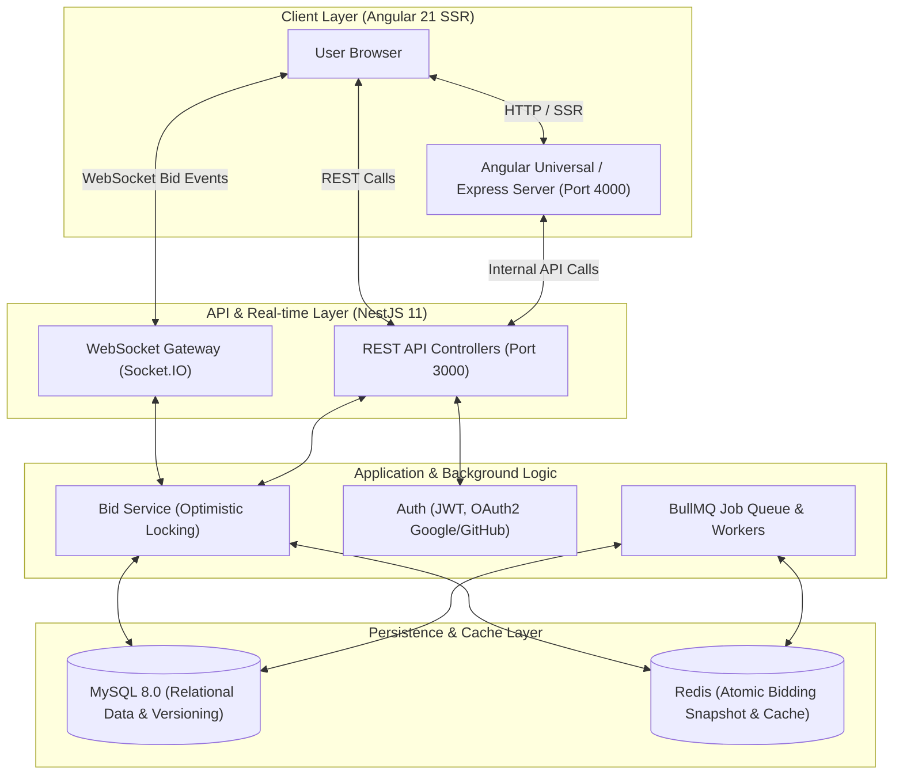

# 🏆 BidBattle — Real-Time Auction Platform

[](https://github.com/Jatyon/bid-battle/actions/workflows/client.yml)
[](https://github.com/Jatyon/bid-battle/actions/workflows/server.yml)
[](https://github.com/Jatyon/bid-battle/actions/workflows/commitlint.yml)
[](LICENSE)
[](.nvmrc)
[](https://www.typescriptlang.org/)
[](https://angular.dev/)
[](https://nestjs.com/)
[](https://www.mysql.com/)
[](https://redis.io/)
[](https://www.docker.com/)

**BidBattle** is an enterprise-grade, high-concurrency real-time auction platform. It couples an **Angular 21 Server-Side Rendered (SSR)** frontend with a modular **NestJS 11** backend, featuring real-time WebSocket bidding, optimistic concurrency control to prevent race conditions, Redis caching with atomic transactions, and BullMQ background task processing.

---

## 📑 Table of Contents

- [Architecture & Overview](#-architecture--overview)
- [Tech Stack](#-tech-stack)
- [Repository Structure](#-repository-structure)
- [Prerequisites](#-prerequisites)
- [Quick Start (Local Development)](#-quick-start-local-development)
  - [1. Clone Repository](#1-clone-repository)
  - [2. Install Dependencies](#2-install-dependencies)
  - [3. Configure Environment Variables](#3-configure-environment-variables)
  - [4. Start Infrastructure via Docker](#4-start-infrastructure-via-docker)
  - [5. Run Database Migrations & Seeds](#5-run-database-migrations--seeds)
  - [6. Start Development Servers](#6-start-development-servers)
- [Available Scripts](#-available-scripts)
- [Testing Strategy](#-testing-strategy)
- [Quality Gates & Git Hooks](#-quality-gates--git-hooks)
- [Docker & Containerization](#-docker--containerization)
- [CI/CD Pipelines](#-cicd-pipelines)
- [Contributing & Security](#-contributing--security)

---

## 🏛 Architecture & Overview

The system is designed around high concurrency, data integrity, and fast real-time user feedback:



### Key Architectural Highlights:

- **Optimistic Locking & Concurrency:** Prevents race conditions during simultaneous bids at milliseconds interval using database row versioning.
- **Atomic Redis Bid Validation:** Validates increment rules and bid limits atomically in Redis before persisting to the relational database.
- **Asynchronous Processing (BullMQ):** Outbids, email notifications, and auction closure events are processed asynchronously off the main HTTP/WebSocket event loop.
- **SSR (Server-Side Rendering):** Fast initial load and SEO optimization for auction listings via `@angular/ssr`.
- **Hybrid Testing Pipeline:** Unit tests paired with true database/cache integration tests via **Testcontainers** (MySQL & Redis).

---

## 🛠 Tech Stack

| Domain                  | Technologies & Libraries                                                                |
| :---------------------- | :-------------------------------------------------------------------------------------- |
| **Frontend**            | Angular 21, `@angular/ssr`, RxJS, Socket.IO Client, Transloco (i18n), Lucide Angular    |
| **Backend**             | NestJS 11, TypeORM, Express, Socket.IO, Passport (JWT, Google, GitHub), BullMQ, Winston |
| **Database & Cache**    | MySQL 8.0, Redis (Alpine), TypeORM Migrations & Seeds                                   |
| **Testing**             | Vitest, Playwright (Chromium Headless), Jest, Supertest, Testcontainers                 |
| **Tooling & DX**        | Husky v9, lint-staged, Commitlint, Prettier, Flat ESLint, TypeScript 5                  |
| **DevOps & Containers** | Docker (Multi-stage Alpine, Non-root `node`, dumb-init), Docker Compose, GitHub Actions |

---

## 📂 Repository Structure

```text
bid-battle/
├── .github/                   # GitHub Actions workflows & PR/Issue templates
│   ├── workflows/             # client.yml, server.yml, commitlint.yml
│   ├── ISSUE_TEMPLATE/        # Standardized bug report & feature request templates
│   └── PULL_REQUEST_TEMPLATE.md
├── .husky/                    # Git hooks (pre-commit, commit-msg)
├── client/                    # Angular 21 SSR Application
│   ├── src/                   # App source code, components, services, layouts
│   ├── Dockerfile             # Multi-stage production build for Angular SSR
│   ├── angular.json           # Angular CLI workspace configuration
│   └── eslint.config.js       # Flat ESLint configuration with prettier alignment
├── server/                    # NestJS 11 REST API & WebSocket Backend
│   ├── src/                   # Modules (auth, bid, auctions, users, shared)
│   ├── test/                  # E2E test suites with Testcontainers setup
│   ├── Dockerfile             # Development container configuration
│   ├── Dockerfile.prod        # Multi-stage production container configuration
│   ├── docker-compose.yml     # Local environment (MySQL, Redis, API, phpMyAdmin)
│   └── eslint.config.mjs      # Server ESLint configuration
├── .editorconfig              # Unified coding style settings (LF, UTF-8, 2 spaces)
├── .gitattributes             # Git LF line-ending normalization rules
├── .lintstagedrc.json         # Git staged files linter & formatter automation
├── .nvmrc                     # Node.js runtime version pin (22)
├── commitlint.config.js       # Conventional Commits rule definition
└── package.json               # Root workspace scripts & orchestrations
```

---

## 📋 Prerequisites

Ensure the following tools are installed on your machine:

- **Node.js**: `>= 22.0.0` (Use [nvm](https://github.com/nvm-sh/nvm) or [fnm](https://github.com/Schniz/fnm): `nvm use`)
- **npm**: `>= 10.0.0`
- **Docker & Docker Compose**: Docker Desktop or Docker Engine `>= 24.0`
- **Git**: `>= 2.30`

---

## 🚀 Quick Start (Local Development)

### 1. Clone Repository

```bash
git clone https://github.com/Jatyon/bid-battle.git
cd bid-battle
```

### 2. Install Dependencies

```bash
# Install root tooling (Husky, Commitlint, Prettier)
npm install

# Install backend dependencies
cd server && npm install

# Install frontend dependencies
cd ../client && npm install

# Return to root directory
cd ..
```

### 3. Configure Environment Variables

Copy the example configuration file in the server package:

```bash
cp server/.env.example server/.env
```

Open `server/.env` and verify/adjust database credentials, JWT secrets, and Redis connection parameters.

### 4. Start Infrastructure via Docker

Spin up MySQL, Redis, and phpMyAdmin with Docker Compose:

```bash
# Launch background services
cd server
docker compose up -d mysql redis phpmyadmin
cd ..
```

- **MySQL**: `localhost:3306`
- **Redis**: `localhost:6379`
- **phpMyAdmin**: [http://localhost:8081](http://localhost:8081)

### 5. Run Database Migrations & Seeds

```bash
cd server
# Run pending migrations
npm run migration:run

# (Optional) Seed demo auction data
npm run seed:run
cd ..
```

### 6. Start Development Servers

You can start the applications simultaneously using root proxy scripts:

- **Start Backend API & WebSocket** (runs at [http://localhost:3000](http://localhost:3000)):

  ```bash
  npm run start:server
  ```

  Swagger API Documentation is available at: [http://localhost:3000/api/docs](http://localhost:3000/api/docs)

- **In a separate terminal, start Frontend** (runs at [http://localhost:4200](http://localhost:4200)):
  ```bash
  npm run start:client
  ```

---

## 📜 Available Scripts

Run from the **root directory**:

| Command                | Description                                                               |
| :--------------------- | :------------------------------------------------------------------------ |
| `npm run start:client` | Starts Angular dev server (`http://localhost:4200`)                       |
| `npm run start:server` | Starts NestJS dev server with watch mode (`http://localhost:3000`)        |
| `npm run build`        | Builds both Angular SSR client and NestJS server                          |
| `npm run build:client` | Compiles production bundle for Angular client                             |
| `npm run build:server` | Compiles production bundle for NestJS server                              |
| `npm run test`         | Executes unit tests across client and server                              |
| `npm run test:client`  | Runs Angular Vitest unit tests                                            |
| `npm run test:server`  | Runs NestJS Jest unit tests                                               |
| `npm run test:e2e`     | Runs NestJS E2E tests using Testcontainers                                |
| `npm run typecheck`    | Validates TypeScript types across both client and server (`tsc --noEmit`) |
| `npm run lint`         | Runs ESLint on both frontend and backend codebases                        |
| `npm run format:check` | Verifies code formatting with Prettier                                    |
| `npm run format:write` | Formats all files across the repository with Prettier                     |

---

## 🧪 Testing Strategy

### Frontend (`client/`)

- **Unit Testing**: Powered by **Vitest** for blazingly fast component and service unit tests.
- **Headless Browser Execution**: Uses Playwright Chromium in headless mode for DOM validation.
- Run via: `npm run test:client`

### Backend (`server/`)

- **Unit Testing**: **Jest** unit tests isolating services and controllers with mocks.
- **E2E Testing**: Real integration tests powered by **Testcontainers**, spinning up isolated ephemeral MySQL and Redis instances for authentic end-to-end reliability.
- Run via: `npm run test:server` or `npm run test:e2e`

---

## 🛡 Quality Gates & Git Hooks

This repository enforces strict code quality and consistency rules prior to commits and pull requests:

- **Husky v9**: Git hooks manager.
- **lint-staged**: Automatically runs ESLint (`--fix`) and Prettier (`--write`) only on staged files upon commit.
- **Commitlint**: Enforces [Conventional Commits](https://www.conventionalcommits.org/) standards (e.g., `feat(bid): ...`, `fix(auth): ...`, `chore(deps): ...`).
- **LF Endings**: Enforced across Windows and Unix platforms via `.gitattributes`.

---

## 🐳 Docker & Containerization

Both applications provide production-ready Docker configurations:

- **Angular Client (`client/Dockerfile`)**:
  - Multi-stage build (Builder -> Production runner).
  - Alpine Linux base image (`node:22-alpine`).
  - Executed as non-root user `node`.
  - Process supervised by `dumb-init` for signal handling.

- **NestJS Server (`server/Dockerfile.prod`)**:
  - Multi-stage build compiling TypeScript to optimized JS.
  - Automated database migration verification in `entrypoint.prod.sh`.
  - Executed as non-root user `node` on Alpine Linux.

---

## 🔄 CI/CD Pipelines

Automated GitHub Actions pipelines ensure stability across every pull request and push to `main`:

1. **Client CI (`client.yml`)**:
   - Change detection filter (`client/**`).
   - Node 22 environment setup with npm cache.
   - Playwright browser binary caching.
   - Linting, TypeScript type-checking (`tsc --noEmit`), unit tests, and production build verification.
2. **Server CI (`server.yml`)**:
   - Change detection filter (`server/**`).
   - Linting, TypeScript type-checking (`tsc --noEmit`), Jest unit tests, Testcontainers E2E tests, and compilation.
3. **Commitlint CI (`commitlint.yml`)**:
   - Validates all commit messages in Pull Requests against Conventional Commits.

---

## 🤝 Contributing & Security

- For development guidelines and commit conventions, see [CONTRIBUTING.md](CONTRIBUTING.md).
- To report a security vulnerability or security bug, please consult [SECURITY.md](SECURITY.md).

---

## 📄 License

This project is licensed under the **ISC License** — see the [LICENSE](LICENSE) file for details.
